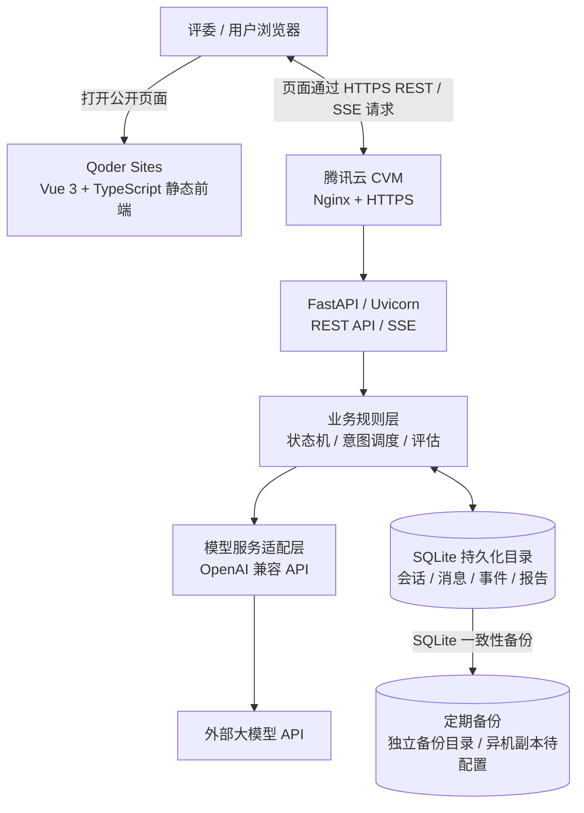
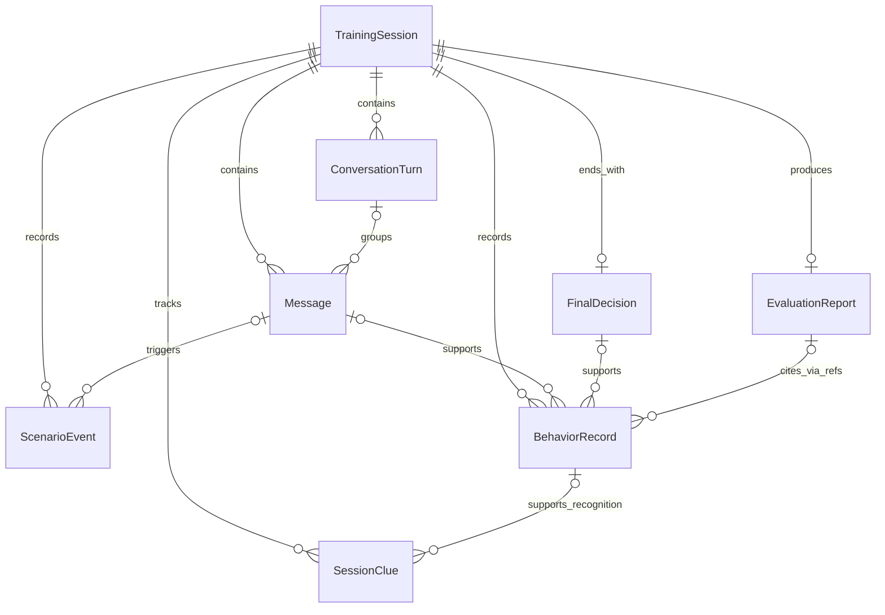

# ScamSense（拆招）架构设计 v1.1

> 版本：**v1.1** · 日期：2026-11-18 · 状态：设计评审稿，尚未进入业务实现或部署。
>
> 交付范围：架构、领域模型、待实现接口契约、运行与验收方案。本文中的配置和命令是后续实施参考，未在腾讯云或 Qoder Sites 执行。
>
> 核心原则：**固定事实，动态触发；固定风险，灵活表达；状态由规则引擎更新，回复由 LLM 生成。**
>
> PR1 评审补充：本次只整理 P0 文档。业务输入尚未冻结，P1–P5 未启动；详见[资料盘点与验收结论](scenario/p0-inventory.md)。

## 1. 文档依据与决策边界

本文初次创建时检查了本地工作区及团队仓库 `mikasa-q/ScamSense` 的 `main` 分支，原有内容仅为 `README.md`，没有旧版 `architecture.md`。本次依据 [PR1 评审与 P0 任务](reviews/pr1-p0-request.md)补充阶段边界、会话体验和业务文档入口，保留现有有效设计，不执行后续阶段。

原始设计依据是《ScamSense 架构文档创建与更新任务 v1.1》和已完整读取的[《角色卡与剧情设计 v1.0》](scenario/characters-and-story-v1.0.md)。后者原文保留，本文保留其中有效的人物、岗位、主线与知识边界。评审已明确保留隐私、安全及部署约束；角色、剧情与技术草案的差异列入[冲突与待确认清单](scenario/p0-inventory.md)，不擅自选择一方覆盖另一方。检查历史提交与 PR 后仍未发现 E01–E16 的具体定义，不将技术事件或示例对应到这些编号。

本文区分三类内容：

- **已确定**：项目定位、三角色设定、固定岗位事实、S0–S6、评估权重、技术栈、前后端分离部署。
- **设计草案**：实体字段、API、状态转移细则、匿名会话访问、重试策略、评分规则组织方式、运行参数；可作为评审输入，开发前按 P0–P4 冻结。
- **TODO**：输入中没有确认的信息；不得将建议参数、示例路径、占位域名或未部署的配置当作事实。

本次只执行 P0 文档整理，不创建业务代码、不安装依赖、不执行部署、不启动 P1–P5。当前没有可用于比赛验收的已验证公开应用地址；GitHub 文档地址也不代替 Qoder Sites 应用地址。

### 1.1 架构约束、阶段交付与实现范围

本文详细列出的工程方案不是“P5 最小骨架必须全部完成”的清单。权限隔离、密钥保护、幂等和证据真实性始终是必要约束；它们与复杂机制是否立即采用是两件事。

| 阶段 | 交付与边界 | 本次状态 |
|---|---|---|
| P0 | 盘点并冻结角色、事件、线索、资料字段、评分依据和分支语义；缺失项由负责人确认 | 仅文档整理；事件和评分仍缺失，未冻结 |
| P1–P4 | 依据获批 P0 输入定义数据结构、状态机、意图和 API 契约 | 仅保留原架构草案；未启动这些任务，不能让后续阶段代为猜测业务事实 |
| P5 | 最小可独立启动的前后端骨架、配置、Pytest 和健康检查 | 未启动；不要求在骨架阶段完成全部聊天、评分和容错能力 |
| 后续业务 MVP | 在明确范围后实现最小训练闭环及必要安全约束，保持既定技术栈 | 后续另行评审，不是本次授权任务 |
| 后续迭代 | 按实际需求、故障或测试结果完善复杂恢复、运维自动化与扩展 | 不提前引入新基础设施 |

| 能力 | 不可省略的约束 | 可在后续评审采用的实现参考 |
|---|---|---|
| 幂等与并发 | 重复请求不能生成重复决定、行为效果或重复得分；鉴权和角色隔离不能削弱 | `ConversationTurn`、通用 `IdempotencyRecord` 等具体结构由后续契约决定，不要求 P5 建表 |
| SSE 与失败 | 流式反馈、明确中断、保留真实证据，不能把未发送草稿当披露或失败当完成 | 显式重试接口、完整片段序号与更细恢复体验按需要评审；未提供的能力不能在 UI 或契约中承诺 |
| 展示与识别 | 没有用户行为不能宣称已识别；没有展示证据不能宣称已阅读 | 展示回执可后续完善；缺少回执时报告诚实标明展示未知，不以猜测替代 |
| 报告 | 分数确定性、证据可追溯、没有量表或足够证据不编造总分 | 若采用本文 `202` 异步契约，就必须有对应持久化与恢复保证；不能只删恢复却继续承诺异步可靠完成，简化方案须先在 P4 评审 |
| SQLite 与运维 | 持久化路径、迁移、基本一致性备份及恢复验证是正式演示前的要求 | WAL 参数、自动化演练、异机运维细化和高并发优化按部署条件/测试推进，不提前更换数据库 |
| 服务与访问 | 正式访问使用 HTTPS、明确 CORS、后端持有密钥、必要访问限制 | systemd/Nginx、timer 和限流数值为部署参考，非 P0 或 P5 当期安装任务 |

已有工程参考和验收项继续保留；只有采用了相应能力，才执行对应专项验收。最小范围由团队在对应阶段确认，本次没有删减必要约束或替团队选择一个新实现。

## 2. 项目定位与用户流程

ScamSense 是 AI 多角色求职反诈模拟训练系统，中文名“拆招”。用户在同一聊天界面内，分别与三个独立 AI 角色交流，通过提问、核实、分析与决策练习识别招聘风险。产品可容纳一个或多个风险角色；**当前已定义场景只有陈浩是隐藏风险角色**，不随机增加其他风险身份。

项目服务于 Qoder 比赛展示、团队工程实践和求职作品积累。它是训练与风险识别模拟工具，不是实际招聘平台，不处理真实求职申请，不接收真实证件、付款或简历附件。

训练关注五件事：招聘主体是否可信、岗位信息是否核实、资料要求是否必要、用户如何寻找证据、最终选择是否与证据一致。最终报告需要说明行为依据，不能只判“选对了角色”或依赖模型印象。

建议的用户流程：阅读模拟及数据保存说明 → 创建会话 → 在三个角色会话间切换 → 提问及核实 → 提交最终决策与理由或提前结束 → 查看带证据的复盘。聊天界面展示姓名和公开身份，不提前显示“正规 HR”“风险 HR”或隐藏动机。用户在自己界面内看到全部私聊，不意味着角色之间共享上下文。

MVP 不包含真实招聘业务、用户账户体系、真实资料上传、支付、后台人工审核系统或多场景编辑平台。匿名会话访问方式见第 9、11 节。

## 3. 固定角色、事实与信息隔离

### 3.1 三个角色

| 角色 / 稳定 ID 草案 | 固定身份与表现 | 可以做什么 | 知识与行为边界 |
|---|---|---|---|
| 林悦 / `lin_yue` | 24 岁，虚构互联网公司招聘专员；专业、直接、务实，可能忙碌、回复慢或使用模板 | 介绍 Python 后端实习；要求合理求职资料；被问及时解释用途、提供预设官方核实渠道；合理催促 | 不主动说教或揭穿陈浩；不知道陈浩隐藏动机、其他私聊或用户未告知的信息；沟通不完美不构成诈骗证据 |
| 陈浩 / `chen_hao` | 27 岁，自称科技公司招聘顾问，通过校园渠道联系用户；热情、专业、及时 | 前期正常介绍岗位；兴趣成立后引导预登记；依配置逐渐出现主体不明、资料超范围及处理过程不透明；被核实时给出有限、缺乏充分依据的解释 | 隐藏动机是利用不透明登记流程收集超必要资料；不提前自曝、不临时编造证明/官方渠道/真实联系方式；不索要费用、验证码、银行卡密码或真实证件照片；拒绝后尊重决定，不骚扰 |
| 王宇 / `wang_yu` | 21 岁，同校计算机专业朋友；随和热心、有求职焦虑，对招聘核实不专业 | 分享校园群见闻；提供有限且未经核实的正面印象；面对具体证据重新考虑 | 知道用户找实习；没核实陈浩、不知其动机；追问时承认不知道；不是故意协助风险角色；不得编造成功入职经历 |

原角色卡同时包含校园群/同学见闻与“室友填过类似登记表”的表达，都不能扩写成亲眼见证陈浩招聘或成功入职的证据。“室友”与泛化同学表述的采纳方式列为[盘点 C01](scenario/p0-inventory.md)：保留原文，由负责人确认来源和措辞，不因资料不足自动替换。所有角色只能要求用户使用虚构占位资料；即使正常 HR 索要简历，也只讨论模拟简历字段，不接收真实简历文件。

### 3.2 固定岗位信息

以下数据来自 v1.0，是虚构剧情事实，不是市场报价，也不能单凭薪资差异认定风险。

| 项目 | 林悦的岗位 | 陈浩的岗位 |
|---|---|---|
| 岗位 | Python 后端开发实习生 | Python 后端开发实习生 |
| 薪资 | 8k–10k/月 | 9k–12k/月 |
| 学历 | 本科及以上，计算机相关专业优先 | 本科及以上，计算机相关专业优先 |
| 技能 | Python、MySQL、HTTP 基础 | Python、MySQL、HTTP 基础 |
| 经验 | 有课程项目或个人项目即可 | 有课程项目或个人项目即可 |
| 工作内容 | API 开发、数据库维护、自动化脚本 | API 开发、数据库维护、自动化脚本 |
| 实习周期 | 3 个月以上 | 3 个月以上 |

TODO：虚构公司名称、工作地点、官方核实渠道的模拟内容、登记字段完整清单及额外字段顺序。模型不得填补这些缺口。任何链接只能指向预设的模拟内容；不自动抓取用户提供的 URL，不把未确认域名当作真实核实渠道。

### 3.3 信息可见矩阵

| 信息 | 林悦 | 陈浩 | 王宇 | 后端规则 / 评估 | 前端训练界面 |
|---|---|---|---|---|---|
| 各自角色卡的获准部分、各自完整聊天 | 仅自己的 | 仅自己的 | 仅自己的 | 按业务读取 | 仅本人会话内公开内容 |
| 已授权共享事实，如用户在找实习 | 允许 | 允许 | 允许 | 允许 | 可展示的部分 |
| 他人私聊及其私有摘要 | 禁止 | 禁止 | 禁止 | 可用于规则与复盘 | 用户自己的消息历史可见 |
| 用户主动转述的他人说法 | 当前聊天中可见 | 当前聊天中可见 | 当前聊天中可见 | 保存来源 | 作为用户转述展示 |
| 风险真相、尚未解锁线索、完整事件条件、评分答案 | 禁止 | 仅投影后的当前行为约束，不注入完整答案 | 禁止 | 服务端专有 | 训练中禁止；复盘按需解释 |
| API Key、访问令牌、内部异常 | 禁止 | 禁止 | 禁止 | 受控配置 | 禁止回显 |

角色调度使用 `session_id + role_id` 查询消息，私有摘要也使用同样分区。一个角色的 Prompt 不得拼接全场对话、其他角色摘要或完整状态对象。用户转述是未经核验的用户陈述，不自动升级为共享事实。

后端以统一、版本化的剧情配置保存事实、角色卡和允许披露清单；注入的内容包括当前阶段、当前允许行为和当前角色可见事实。隐藏角色的完整动机存于配置，运行 Prompt 只获得本轮所需的行为边界，避免提前泄露整个剧本。所有角色只产出语言；即使返回 `stage`、`score` 或类似指令，也不成为状态写入来源。

P0 的逐角色、逐阶段及用户转述边界见 [role-visibility.md](scenario/role-visibility.md)。阶段变化不等于全角色事实同步，尚未提供的事件授权白名单仍为 TODO。

## 4. 已确定技术栈与总体架构

| 模块 | 已确定选择 | 边界 |
|---|---|---|
| 前端 | Vue 3、TypeScript、Vite、Element Plus | 静态构建，不运行服务端逻辑 |
| 路由与状态 | Vue Router、Pinia | 页面与 UI 状态；服务端才是业务状态权威 |
| 后端 | Python、FastAPI、Pydantic、Uvicorn | REST、SSE、输入输出校验、领域服务 |
| 持久化 | SQLite、SQLAlchemy 2.x、Alembic | 单台 CVM 的持久化本地磁盘，版本化迁移 |
| AI | OpenAI 兼容 API | 后端适配层统一调用，供应商及模型 TODO |
| 通信 | HTTPS REST、SSE | SSE 为服务器向浏览器的单向事件流 |
| 运行 | Nginx、systemd | HTTPS 代理、进程守护与定期任务 |
| 发布 | Qoder Sites 前端 + 腾讯云 CVM 后端 | Qoder Free 按任务约束只部署静态前端 |
| 测试 | Pytest | 领域单测、API 与流式集成测试 |

MVP 采用模块化单体，不引入 Redis、微服务、消息队列、向量数据库或 LangGraph。未来确有并发、可靠后台任务或多实例需求时，先评审再扩展。



浏览器分别访问静态站点与腾讯云 API，跨域由后端明确配置。Qoder Sites 不代理模型密钥，也不承载 FastAPI 或 SQLite。Nginx 将接口转发到仅监听回环地址的 Uvicorn；前端静态页面由 Qoder Sites 提供。

## 5. 模块边界与请求处理

### 5.1 后端职责

| 模块 | 输入 → 输出 | 允许持有的职责 |
|---|---|---|
| 会话管理 | 创建/查询/暂停/恢复/结束命令 → 会话快照 | 生命周期、匿名访问权、过期与并发入口；终结交由规则层 |
| 消息管理 | 用户输入 → 消息、轮次与 SSE | 校验、持久化、幂等、发送状态、断线后的历史查询 |
| 角色调度 | 角色 ID、可见事实、当前阶段 → 独立 Prompt | 上下文隔离、截断/摘要、披露约束；不决定阶段 |
| 意图识别 | 当前用户消息与必要的本角色上下文 → 结构化候选意图 | 类型、置信度、参数、原文证据；无数据库状态写权限 |
| 状态机 / 规则引擎 | 已校验意图或明确命令 + 持久化快照 → 规则效果 | 合法转移、事件触发、版本检查、线索计划、幂等业务结果 |
| 线索管理 | 配置线索、可见消息片段、用户证据 → 披露与识别记录 | 将披露、展示回执、注意/识别、核实动作分开记录 |
| 行为记录 | 经规则确认的用户行为 → 可追溯行为证据 | 发生阶段、关联消息、原文片段、证据类型；不凭角色发言推断用户能力 |
| 评估报告 | 冻结的会话、行为、线索、最终决策 → 分项及总分、建议 | 固定权重和规则计算；LLM 可润色解释，不能覆盖分数或引用 |
| 模型适配 | 用途、模型配置、消息、超时预算 → 流或校验后结果 | 超时、限流、重试边界、结构错误、用量；隐藏供应商细节 |

API 层负责鉴权、Pydantic 校验与 DTO；领域服务负责规则；SQLAlchemy 负责持久化。模型适配器不知道如何修改会话。数据库写操作由服务层的短事务统一组织，不在网络等待期间持有 SQLite 写事务。

### 5.2 前端职责

- `api/` 统一读取 `VITE_API_BASE_URL`，封装 REST、带鉴权的 `fetch` SSE 解析与错误处理。
- `stores/` 按会话和角色分别保存显示消息、流状态与服务端版本；不在 Pinia 中推导真实评分或推进阶段。
- 聊天页在同一界面切换三个角色，可显示合并的用户视图，但发送消息必须指定唯一目标角色。
- 报告页展示四维得分、证据链接、未观察到的事项与建议，不把失败的模型输出展示为正式报告。
- 路由草案为 `/`、`/training/:id`、`/reports/:id`。Qoder 路由回退未验证前，优先采用 Vue Router hash 模式；history 模式必须先通过刷新直达验收。平台实际能力为 TODO。

### 5.3 一个聊天轮次的处理顺序

1. 校验会话令牌、状态、角色、长度和 `Idempotency-Key`，拒绝过期或超额请求；扫描可能的敏感资料，在写库和外发模型前拦截。
2. 短事务 A 创建 `ConversationTurn` 和唯一用户 `Message`，占用会话的活动轮次；幂等键相同且请求体相同则返回原轮次，不重复保存用户输入。
3. 在事务外调用意图识别，校验结构、原文证据及枚举。低置信度或失败走澄清，不推进高影响业务。
4. 短事务 B 重新检查会话版本和活动轮次，规则引擎应用已确定的用户行为、合法阶段变化及事件日志。生成当前角色获准回复的事实与线索计划。**计划披露不等于已经披露。**
5. 事务外生成角色回复。按经过约束检查的句子/短片段持续处理，在短事务内先保存该片段与对应的线索证据，再发送 SSE `delta`；不逐 token 打开写事务，不等完整回答生成结束才开始流式发送。
6. 成功时短事务 C 标记角色消息完整、轮次完成并释放占用，再发送 `complete`。异常时保存已持久化的部分回复、标记 `failed/interrupted` 并释放占用；已真实发生的用户行为及已披露线索不回滚。

阶段由用户行为产生的变化可先于回复完成；由线索披露产生的变化必须与对应可见片段在同一事务落库。任何阶段变化均有 `from_stage`、`to_stage`、规则版本和原因。断流不会把已经显示过的内容恢复成“从未披露”。

初始问候使用版本化的预设公开事实/模板，落库后才展示，不借初始化执行未定义的 E 事件。上下文重建可以纳入本角色已经持久化且获准可见的部分回复，但必须标明 `interrupted/failed`，不得当作完整回答或加入未审核草稿；已经披露的线索也以本角色获准事实投影注入，防止重试时自相矛盾。

## 6. 剧情、事件与状态机契约草案

### 6.1 固定主线

故事为**《那个看起来很正规的实习机会》**。用户是一名寻找 Python 后端实习的大学生；林悦、陈浩分别介绍岗位，王宇分享校园群见闻。

| 阶段 | 含义 | 可发生的业务 |
|---|---|---|
| S0 初始接触 | 建立场景 | 三个角色各自介绍/问候；不提前暴露风险 |
| S1 了解机会 | 了解岗位、主体、薪资、技术、流程 | 自由询问，HR 按固定事实回答 |
| S2 候选人预登记 | 已表达对陈浩机会的兴趣 | 依次讨论姓名、学校、专业、毕业时间、模拟简历及项目经历，再讨论可实习时间、城市、求职意向；全是虚构占位资料 |
| S3 信息风险线索 | 有条件地披露资料及主体风险 | 额外字段必须来自配置；模型不得临时新增敏感资料要求 |
| S4 主动核实 | 用户要求证据、核对来源与处理方式 | 可向林悦询问正常流程、向王宇追问来源、向陈浩核实主体/用途/保存期限/接收方/官方渠道；顺序自由 |
| S5 最终决策 | 用户明确提交决定或提前结束 | 冻结证据快照，进入报告计算；不继续聊天 |
| S6 训练复盘 | 报告完成 | 展示风险、行为证据、决策分析和改进建议 |

`stage` 表示会话已进入的主线里程碑，并不意味着三个角色都执行过同一阶段，也不能单独授权披露。每条线索还必须检查角色、前提和当前行为。提前进入 S4 后可以继续询问岗位或补充发现线索，阶段保持 S4，不需要回退到 S1/S3。

### 6.2 会话生命周期与阶段分开

生命周期草案：`active`（可聊天）、`paused`（保留会话但不接收聊天）、`evaluating`（决策已提交）、`completed`（报告已生成）、`expired`（访问/训练有效期结束）。暂停只由明确 UI 命令控制，恢复返回原阶段。基础设施失败属于轮次或报告状态，不把会话伪装为已完成。

“暂缓提交资料”是业务行为，可继续核实；“最终决定暂缓”是提交决定并复盘；“暂停训练”则是生命周期 `paused`。三者不能由一个模糊词自动混同。

### 6.3 转移规则草案

| 当前阶段 / 状态 | 合法输入及守卫条件 | 结果 |
|---|---|---|
| S0 / active | 已建立初始事实，用户询问岗位或流程 | S1；记录问题，不凭聊天次数推进 |
| S0、S1 / active | 对陈浩岗位的明确兴趣；配置允许预登记引导 | S2；仅允许当前登记层级，不等于同意提交任何资料 |
| S2 / active | 已满足具体线索的触发条件，线索片段持久化并可供展示 | S3；分别记披露事实与转移，不自动判用户识别 |
| S0–S3 / active | 有原文证据的主动核实、询问来源或要求独立证据 | 可直接进入 S4；不要求先经过 S2/S3 |
| S1–S4 / active | 普通继续对话、补充问题或允许的更多线索 | 保持当前阶段或按上面的合法条件推进；S4 不倒退 |
| S0–S4 / active | 对正常 HR/朋友的兴趣或闲聊 | 不触发陈浩的预登记；只记录对应行为 |
| S0–S4 / active 或 paused | 用户通过决策接口确认选择、理由和当前版本 | S5 / evaluating；冻结终结快照、创建唯一决定 |
| S0–S4 / active 或 paused | 用户明确提前结束，但未提交选择 | S5 / evaluating；决定记为 `undecided`，原因 `ended_early`，不猜测其选择 |
| S5 / evaluating | 规则评分及证据校验成功，报告持久化 | S6 / completed；若失败保持 S5 并允许报告重试 |
| S0–S4 / active | 明确暂停且无活动轮次 | 阶段不变，paused；恢复须未过期 |
| 任意未过期会话 | 到达保存/访问期限 | expired；不可再触发聊天或决策，按清理策略处理 |

跳过剧情通过提前核实或明确决策实现，不存在允许客户端任意写 `stage` 的接口。纯聊天拒绝/停止的识别结果可以记录倾向并提示决策入口，**最终决定、结束、暂停等高影响动作必须使用明确命令接口**。不要求用户凑满聊天轮数，不使用模型回复次数或计时器自动推进主线。

非法阶段转移、会话已终结或版本冲突返回 `409` 及稳定错误码，不悄悄修正为另一个状态；没有匹配规则的普通输入保持原状态，回复或澄清。结构非法返回 `422`；低置信度本身不是接口错误。

### 6.4 规则输入、输出、顺序与幂等

规则输入草案：`session_snapshot`、`state_version`、`turn_id/command_id`、`actor_role_id`、已校验 `IntentResult`、剧情/规则版本、当前线索与事件状态。客户端或模型提交的状态字段不属于输入权威。

规则输出草案：`next_stage`、`behavior_records`、`event_occurrences`、`disclosure_plan`、`allowed_fact_ids`、`reply_constraints`、`needs_clarification`。输出由服务层校验后在事务内应用，不能将任意模型 JSON 合并到实体。

处理优先级：有效的显式生命周期/决策命令 → 安全与访问校验 → 核实及证据行为 → 常规推进 → 普通对话。矛盾的多意图不同时执行“继续”和“拒绝”，转为澄清。单次执行允许记录多个有证据的行为，阶段最多进行一次有效推进；S5 → S6 是独立的报告完成动作。

并发与幂等约束：

- 同一会话同一时间最多一个活动聊天轮次；跨角色也串行。另一请求返回 `409 TURN_IN_PROGRESS`。只有前端禁用按钮不足以保证这一点，数据库事务必须校验。
- 修改请求使用 `Idempotency-Key`；以会话、操作类型、键建立唯一约束，创建会话使用独立创建请求作用域。相同键与不同请求体返回 `409 IDEMPOTENCY_CONFLICT`。
- 会话持有递增 `state_version`；消息、决策及生命周期操作检查 `expected_version`。重放已有幂等结果优先于版本检查，避免成功请求在客户端重试时被误判为新操作。
- `ScenarioEvent` 按 `session_id + event_key + occurrence_key` 去重；一次性剧情事件使用固定 occurrence key，重复业务动作使用稳定的轮次/命令 ID。行为按轮次与证据片段去重，不能靠重复提问刷分。
- 事务失败不发“已完成”事件。进程重启后将遗留 `processing` 轮次标为 `interrupted` 并释放占用，依据持久化标志判断规则是否已执行；不从头重放已提交的规则动作。

### 6.5 E01–E16 事件定义待补齐

`ScenarioEventDefinition` 是版本化配置，`ScenarioEvent` 是具体会话中的发生日志，不能混为一张“事件当前状态”表。定义接口草案如下，**不是任何一个已有事件的补写**：

```json
{
  "event_id": "E01",
  "scenario_version": "TODO",
  "name": "TODO",
  "allowed_stages": [],
  "eligible_role_ids": [],
  "preconditions": [],
  "intent_predicate": null,
  "allowed_effects": [],
  "disclosure_clue_ids": [],
  "repeat_policy": "TODO"
}
```

E01–E16 的逐项 TODO 现统一登记在 [events.md](scenario/events.md)，避免维护两份相同事件表。该文件包含事件名称、目的、条件、阶段、来源、效果、披露、可见影响、用户行为、重复、依赖/互斥/优先级、失败处理、验收及来源确认的完整填写要求；16 项仍全部未冻结。上面的 JSON 仅为既有技术接口草案，不能代替 P0 业务定义。

未冻结的事件禁止启用，不自动把空条件解释为无条件成立。技术事件使用独立命名，例如 `session.created`、`intent.clarification_required`、`stage.changed`、`clue.disclosed`、`turn.interrupted`、`decision.submitted`、`report.generated`，不占用 E01–E16。

## 7. 意图识别、线索与评估

### 7.1 意图识别契约草案

意图集合建议包括：`ask_job`、`express_interest`、`verify_employer`、`ask_data_scope`、`ask_data_purpose`、`ask_retention`、`ask_recipient`、`request_official_channel`、`ask_friend_source`、`identify_risk`、`continue_registration`、`decline`、`defer`、`end_training`、`other`。是否拆分更多子类在 P3 冻结。

```json
{
  "schema_version": "intent.v1",
  "message_id": "msg_example",
  "intents": [
    {
      "type": "ask_data_purpose",
      "confidence": 0.94,
      "parameters": {"field_id": null},
      "evidence": {"text": "这些资料具体用来做什么？", "start": 0, "end": 12}
    }
  ],
  "ambiguous": false,
  "clarification": null
}
```

`start/end` 使用 Python/Unicode code point 的半开区间；前端不得以 JavaScript UTF-16 索引直接解释。示例只说明格式，实际证据必须与原文完全匹配；`message_id` 由后端绑定，模型不能替换来源。置信度限定在 `[0,1]`，参数只接受已知字段/角色 ID，未知参数保留空值。

置信度阈值建议从 0.85 起做标注集校准，**TODO：P3 冻结阈值与样本集，不将模型自报置信度当作概率保证**。低于阈值、矛盾多意图、证据不匹配或无法识别时，记录不确定性并要求澄清；不得据此确认最终决定、结束、披露敏感线索或给用户记下已识别风险。高置信度也不能绕过显式决策接口。

兼容的多意图按证据分别记录，例如同时询问主体与用途；多个意图共享同一证据时保留引用，评分时按规则去重。模型超时或结构失败可进行一次受限的格式纠正，仍失败则用预设澄清回复；不依赖纠正模型执行业务动作。

### 7.2 线索与用户行为的分离

原剧情已确认以下五类线索；稳定 clue ID、具体触发规则、披露文本及 E01–E16 映射仍为 TODO。

P0 详细证据与观察边界见 [clues.md](scenario/clues.md)，九项已有登记资料及未提供的额外字段见 [data-fields.md](scenario/data-fields.md)。其中整理索引不是新的业务 ID，用途讨论方向不是已确认的收集授权。

| 固定线索主题 | 可记录的用户证据示例（不是预设剧情事件） |
|---|---|
| 岗位、顾问、实际资料收集主体之间存在差异 | 用户指出主体不一致，并要求解释招聘关系 |
| 部分资料用途解释不充分、必要性不明 | 询问用途、指出超范围，选择只提供必要的模拟字段 |
| 保存期限及第三方处理缺乏说明 | 询问保存多久、谁接收、是否能撤回 |
| 无法获得足够的独立官方核实依据 | 请求独立渠道，并分析回复是否能验证 |
| 朋友承认未核实 | 追问信息来源，区分群聊传言和亲自确认 |

至少区分：

1. **披露**：后端已将获准线索写入用户可见消息片段，保存时间、消息 ID 与字符范围。
2. **展示回执**：客户端确认渲染至哪个片段；只能称“已展示”，不能证明用户阅读或理解。无回执时为“可查看，展示情况未知”。
3. **注意 / 识别**：用户提及线索可记 `clue_mentioned`；明确指出其风险或证据不足才记 `risk_identified`，都必须引用用户原文。
4. **核实行动**：用户提出证据请求或执行模拟核实，记录独立 `BehaviorRecord`。提出问题不等于已成功核实，角色口头保证不等于获得独立证据。

披露计划、模型内部想法和未发送草稿不能记为披露。SSE 已持久化但网络中断的片段仍可通过历史查看，报告必须标注展示不确定，不能直接认定用户“看到了却没发现”。用户可以在未披露时提出预防性核实，照样记录行为，不强制先出现线索。

### 7.3 评分与报告

| 维度 | 固定权重 | 证据重点 |
|---|---:|---|
| 风险识别 | 25% | 是否指出主体、必要性、用途、接收方等问题，并引用具体线索 |
| 主动核实 | 30% | 是否主动提问、追溯来源、要求独立渠道，以及收到含糊回答后如何继续 |
| 决策合理性 | 25% | 决策理由是否与已掌握证据一致，是否采用必要资料最小化、暂缓或进一步核实 |
| 证据分析 | 20% | 是否区分朋友背书、角色声称、可核查事实，是否解释证据缺口 |

既有技术草案以每维 0–100 表达得分，正常评分时使用下式；该表达方式不包含获批的业务档位或条目分值：

`总分 = round(风险识别 × 0.25 + 主动核实 × 0.30 + 决策合理性 × 0.25 + 证据分析 × 0.20, 2)`

计算使用固定版本的规则量表。量表条目草案包含 `rule_id`、`dimension`、`points`、`applicability`、`evidence_predicate`、`dedup_key`；条目分值、适用条件、覆盖率门槛和各维上限 **TODO：先在 P0 由负责人确认，不能留给 P1–P4 自行猜测**。同一行为可为不同能力维度提供证据，但不能在同维重复累计同一判据；具体跨维和去重口径仍须冻结。

[scoring-rubric.md](scenario/scoring-rubric.md)整理了四维观察材料、证据要求、每维三个边界案例和量表填写表。当前没有获批的数字分档，因此不能输出自拟分数或宣称评分标准已可执行。P2 将来只表达已批准业务规则，本次不进入 P2。

报告逐条保存 `rule_id → behavior_ids → message_ids/原文片段 → 相关线索/事件`。无证据的“主动核实”“已经识破”不得给分；最终选择“拒绝”也不能自动满分，继续选择必须结合所掌握信息和理由评估。

报告区分 `graded` 与 `insufficient_evidence`。量表的适用项、已披露/已展示/已识别/已核实数量和未观察项必须展示；未出现线索不能写成“用户忽略了已出现线索”。可判断的遗漏可按冻结量表计分，系统未提供机会的条目标为不适用；证据覆盖不足时相应维度及总分为 `null`，不能靠缩小分母或重新分配四维权重给出高分。TODO：冻结早退与机会覆盖的评分口径。

规则引擎先产出结构化分数和引用，LLM 仅可在此基础上组织复盘语言。解释引用不合法、增添不存在事实或模型不可用时，使用规则模板展示，保留确定性分数。分数暂不可计算时仍可生成说明证据不足的报告；基础设施故障则保持报告待处理或失败，不能伪装成证据不足。

## 8. 数据模型与持久化边界

以下字段是领域草案，数据库物理列名、JSON 结构与迁移在 P1 冻结。ID 使用服务端生成的 UUID；时间存 UTC，展示时转换时区；JSON 使用带版本的明确结构并经 Pydantic 校验。外键启用 `PRAGMA foreign_keys=ON`，同会话证据引用由服务层及必要约束双重检查，禁止引用另一用户的消息。

### 8.1 核心实体

| 实体 | 核心字段与职责 | 约束与持久化 |
|---|---|---|
| `TrainingSession` | `id`、`scenario_id`、`scenario_version`、`rules_version`、`prompt_version`、`rubric_version`、`stage`、`status`、`state_version`、`access_token_hash`、`expires_at`、`active_turn_id`、`created_at`、`ended_at` | 全部持久化；阶段 S0–S6，状态见 6.2；版本非负；只保存高熵会话令牌的哈希；每会话至多一个活动轮次；`ended_at` 表示用户提交决定/提前结束时间 |
| `Message` | `id`、`session_id`、`turn_id`（初始消息可空）、`role_id`、`sender`、`content`、`status`、`created_at`、`completed_at`、`metadata` | `sender=user/assistant/system`；目标角色必须合法，系统消息需显式可见范围；`status=accepted/streaming/complete/interrupted/failed`；内容及获准发送的部分回复持久化；元数据含片段边界、模型请求 ID、输出尝试号，不含密钥、Prompt 或思维链 |
| `ScenarioEvent` | `id`、`session_id`、`event_key`、`event_type`、`definition_version`、`occurrence_key`、`triggered_at`、`source_message_id`、`turn_id/command_id`、`from_stage`、`to_stage`、`reason`、`condition_snapshot`、`effects` | 追加式业务日志；`event_key` 是 E 编号或技术事件名；条件快照只含命中规则和必要事实引用；唯一键见 6.4；不把模型原文当可执行条件 |
| `SessionClue` | `id`、`session_id`、`clue_id`、`disclosed`、`disclosed_at`、`disclosure_message_id`、`disclosure_span`、`rendered_at`、`noticed_at`、`recognized`、`recognized_at`、`recognition_behavior_id` | `(session_id,clue_id)` 唯一；未披露时披露证据为空；识别为真必须有用户行为证据；用户预防性识别可先于披露，不能强制 `recognized ⇒ disclosed`；多次披露由事件日志保存，首次字段不被覆盖 |
| `BehaviorRecord` | `id`、`session_id`、`turn_id`、`behavior_type`、`occurred_at`、`message_id`、`decision_id`（可空）、`stage_at_action`、`clue_id`（可空）、`evidence_text/span`、`source_kind`、`intent_confidence`、`rule_id` | 行为如提问、核实请求、线索提及、风险识别、继续、拒绝、暂缓；必须有用户消息或明确决策来源；`source_kind=message/explicit_command`；不得只引用角色回复作为用户行为 |
| `FinalDecision` | `id`、`session_id`、`choice`、`reason`、`submitted_at`、`source`、`evidence_snapshot_version` | 每会话最多一条，提交后不可覆盖；`choice=continue/necessary_only/verify_first/decline/defer/undecided`；`undecided` 仅由提前结束产生；来源为明确接口命令；理由可为空，但报告要说明证据不足 |
| `EvaluationReport` | `id`、`session_id`、`status`、`assessment_status`、四维 `dimension_scores`、`total_score`、`evidence_refs`、`coverage`、`strengths`、`suggestions`、`rubric_version`、`evidence_snapshot_version`、`generated_at`、`error_code` | 每会话一份当前报告；`status=pending/generating/ready/failed`；分数在 0–100 或按证据不足规则为 null；ready 时必须有可验证引用及稳定快照；业务评分不随润色重试变化 |

为兑现当前草案的断线重试与幂等契约，原设计列出两个小型技术实体作为后续评审参考，不引入新的基础设施；它们尚未冻结，不要求在 P5 骨架阶段建表：

| 实体 | 必要字段及边界 |
|---|---|
| `ConversationTurn` | `id`、`session_id`、`role_id`、`user_message_id`、`status`、`attempt_no`、`current_assistant_message_id`、`last_seq`、`rules_applied`、`rule_result_ref`、`error_code`、起止时间；状态 `processing/complete/failed/interrupted`，重试使用同一用户消息，旧尝试的部分回复保留并标明状态 |
| `IdempotencyRecord` | `scope`、`key`、`request_hash`、`resource_id`、`result_status`、不含秘密的 `response_snapshot`、`expires_at`；`(scope,key)` 唯一，与对应业务写入同事务；保留至少覆盖会话有效期；已有会话路由在过期后不可复活会话，创建请求在去重窗口以外不承诺永久去重 |

创建会话的初次响应包含一次性返回的原始会话令牌，幂等记录不保存该秘密。若创建响应丢失，携带相同创建键且无有效会话令牌的重试返回 `409 CREATION_ALREADY_EXISTS`，不泄露会话详情、不创建第二份，也不重新签发令牌；客户端明确提示后使用新键重新创建，原孤立会话到期清理。持有令牌时可查询已创建会话。该限制必须在前端处理，不能承诺无令牌恢复匿名会话。

### 8.2 实体关系



最后一条表示报告对行为的证据引用；MVP 存在经校验的 `evidence_refs` JSON 中，不代表给行为增加必须反向依赖报告的外键。报告引用消息、事件和线索也采用可校验证据引用；核心会话/消息关系使用实际外键。清理按整个会话删除，不在保留报告时单独删除其证据。

推荐索引：消息 `(session_id,role_id,created_at,id)`、事件 `(session_id,triggered_at,id)`、行为 `(session_id,behavior_type)`、会话 `(status,expires_at)`，以及上文唯一约束。实际索引需随查询计划确认，避免提前增加无用途索引。

### 8.3 SQLite 使用边界

MVP 建议单台 CVM、一个 Uvicorn worker，异步模型网络调用与短数据库事务分离。SQLAlchemy Session 按请求/短事务创建，不能跨异步任务共享，不能把流式请求整个生命周期包在一个事务里。同步 ORM/SQLite 访问使用受限线程池，避免阻塞 FastAPI 事件循环。

建议启用 WAL、每连接外键、有限 `busy_timeout`（初始建议 5000 ms，需压测确认），以条件更新 `state_version` 和事务内唯一约束保证一致性。SQLite 同时只有一个写者；WAL 改善读写并发但不提供多写者能力。忙锁超时返回可恢复 `503 STORAGE_BUSY`，不无限重试、不把失败写入当成功。

库文件建议 `/var/lib/scamsense/scamsense.db`，备份建议 `/var/backups/scamsense/`，均为**待服务器环境确认的建议路径**。数据库、WAL/SHM 与备份位于受保护持久化目录，不在 `/tmp`、代码发布目录、静态站点或网络共享文件系统。跨请求全局限流与并发阈值在单进程内即可；只有运行一个 worker 时这些限制才覆盖整个实例。

若压测持续出现写锁、需要多副本/多机高可用、持久化任务调度或写吞吐超过可接受范围，再评审 PostgreSQL 和相应迁移方案。MVP 不提前引入。磁盘余量、实际容量及并发承诺为 TODO，不从未确认的 CVM 规格推断。

## 9. REST API 待实现契约

本节全部路径、字段和状态码为 **P4 待冻结契约**，不是已可调用的服务。统一前缀 `/api/v1`，默认 JSON，时间用 RFC 3339 UTC。所有会话资源需要 `Authorization: Bearer <session_token>`；ID 本身不是访问凭证。

### 9.1 接口清单

| 方法与路径 | 请求与成功响应 | 关键规则 |
|---|---|---|
| `POST /sessions` | `{scenario_id,privacy_notice_version}` → `201 {session,session_token,expires_at}` | 创建 S0/active，会话令牌只返回一次；`Idempotency-Key` 必填；无账号登录，限制创建速率；场景配置未就绪返回 `503 SCENARIO_NOT_READY` |
| `GET /sessions/{id}` | → `200` 会话公开快照、角色公开信息、活动轮次、报告状态、版本 | 不返回风险身份、隐藏线索、Prompt、令牌哈希或内部触发条件 |
| `GET /sessions/{id}/messages?role_id=...&cursor=...&limit=...` | → `200 {items,next_cursor}` | 角色必填，建议默认 50、最大 100 条；按时间与 ID 稳定分页；可见部分回复带状态 |
| `POST /sessions/{id}/messages` | `{role_id,content,expected_version}` → `200 text/event-stream` | `Idempotency-Key` 必填；创建轮次并流式输出，见第 10 节 |
| `POST /sessions/{id}/turns/{turn_id}/retry` | `{expected_version}` → SSE | 新幂等键，仅失败/中断轮次；仅在会话版本与该轮次最近失败快照一致、期间没有新聊天/决策时允许；同一用户消息不重复执行规则 |
| `POST /sessions/{id}/messages/{message_id}/receipt` | `{attempt_no,last_rendered_seq}` → `204` | 只接受本会话已持久化片段序号；单调推进回执，天然幂等；不产生风险识别分数 |
| `POST /sessions/{id}/decisions` | `{choice,reason,expected_version}` → `202 {decision,report_status,session}` | 明确用户确认；无活动轮次；写入唯一最终决定，S5/evaluating |
| `POST /sessions/{id}/end` | `{reason,expected_version}` → `202 {decision,report_status,session}` | 提前结束并记 undecided；无活动轮次；报告复用相同流程 |
| `POST /sessions/{id}/pause`、`POST /sessions/{id}/resume` | `{expected_version}` → `200 {session}` | 明确生命周期命令，状态机合法性和幂等均检查 |
| `GET /sessions/{id}/report` | 未终结 `409 REPORT_NOT_REQUESTED`；计算中 `202`；就绪 `200`；生成失败 `503 REPORT_FAILED` | `202` 含 `Retry-After`；短时有限轮询并在终态停止；GET 不触发写入/重算 |
| `POST /sessions/{id}/report/retry` | `{expected_version}` → `202` | 仅失败或重启后恢复为待处理的报告；固定原证据快照，不生成第二份决定或新分数版本 |
| `GET /health/live` | `200 {status:"ok"}` | 无鉴权，仅存活检查，不输出配置 |
| `GET /health/ready` | 就绪 `200`，否则 `503` | 检查数据库可读、迁移版本及必需配置存在；不展示密钥/路径，不每次调用收费模型接口 |

所有修改操作（展示回执除外）使用幂等键；请求体中的 `expected_version` 对已有会话的业务修改必填。只读请求无副作用。对于跨会话 ID 或错误令牌，可统一返回不可枚举的 `404`；缺失鉴权为 `401`，过期的有效访问凭证为 `410 SESSION_EXPIRED`。

### 9.2 请求与响应示例

创建请求示例：

```http
POST /api/v1/sessions HTTP/1.1
Content-Type: application/json
Idempotency-Key: <client-generated-uuid>

{"scenario_id":"internship_v1","privacy_notice_version":"TODO"}
```

`internship_v1` 仅为场景 ID 建议，需 P0 冻结；占位隐私版本不得直接用于正式验收。创建响应草案：

```json
{
  "session": {
    "id": "session_example",
    "stage": "S0",
    "status": "active",
    "state_version": 0,
    "roles": [
      {"id": "lin_yue", "name": "林悦", "public_title": "招聘专员"},
      {"id": "chen_hao", "name": "陈浩", "public_title": "招聘顾问"},
      {"id": "wang_yu", "name": "王宇", "public_title": "大学朋友"}
    ]
  },
  "session_token": "<one-time-returned-random-token>",
  "expires_at": "<RFC3339-UTC>"
}
```

聊天请求示例：

```json
{"role_id":"chen_hao","content":"这些资料具体用来做什么？","expected_version":0}
```

最终决策示例：

```json
{"choice":"verify_first","reason":"还未确认资料由谁收集，先核实再决定。","expected_version":7}
```

报告响应包括 `report_id`、`status`、`assessment_status`、`rubric_version`、四维 `dimension_scores`（分值、权重、证据引用）、`total_score`、`coverage`、`strengths`、`suggestions`。证据引用可通过本会话消息历史定位；报告不暴露模型系统 Prompt 或其他会话内容。

普通错误统一格式：

```json
{
  "error": {
    "code": "VERSION_CONFLICT",
    "message": "会话已更新，请刷新后重试。",
    "request_id": "request_example",
    "retryable": false,
    "details": {"current_version": 8}
  }
}
```

`400` 用于损坏的请求；`413` 体积超限；`422` 字段不合法；`429` 限流并带 `Retry-After`；`502/503/504` 对应上游故障、服务暂不可用或超时。错误 `details` 只返回安全字段，不回显原始模型响应、密钥、堆栈或用户敏感输入。

### 9.3 报告生成与恢复

如果后续选择本文的异步 `202` 契约，决策事务原子写入 FinalDecision、证据快照版本、pending 报告和 S5/evaluating，使用单进程内的受限任务执行器计算报告，不增加队列服务；pending/failed 状态持久化，不能只依赖 FastAPI 内存后台任务。启动时扫描 pending 以及遗留 generating 的报告，按固定快照幂等恢复；没有这个恢复流程就不满足该异步契约。最终报告和 S6/completed 在同一事务提交。是否采用整套异步方案须在 P4 评审，本次仅保留参考，不把它列为 P5 骨架必做项。

报告计算优先使用确定性规则，模型润色失败直接降级模板；数据库不可用等基础设施问题记录可恢复失败。重复获取报告不重复调用模型，重复重试不并发启动同一报告任务。

## 10. SSE 流式契约与故障处理

### 10.1 请求方式与事件格式

采用 **POST + 浏览器 `fetch`/ReadableStream**，请求与 9.1 一致；原生 `EventSource` 不能满足 JSON POST 与本契约的 Authorization 头，MVP 不使用它，也不使用 WebSocket。

响应头至少包含：

```http
Content-Type: text/event-stream; charset=utf-8
Cache-Control: no-cache, no-transform
X-Accel-Buffering: no
X-Request-Id: <request-id>
```

每个事件以空行结束，`data` 为单行 JSON；id 草案为 `<turn_id>:<attempt_no>:<seq>`。`seq` 在每次尝试中单调递增，`delta` 只传新增片段，不能混用累计全文。

```text
id: turn_example:1:0
event: start
data: {"turn_id":"turn_example","attempt_no":1,"seq":0,"user_message_id":"msg_user","assistant_message_id":"msg_reply","role_id":"chen_hao","replayed":false}

id: turn_example:1:1
event: delta
data: {"turn_id":"turn_example","attempt_no":1,"seq":1,"message_id":"msg_reply","text":"我可以先介绍登记流程。"}

id: turn_example:1:2
event: complete
data: {"turn_id":"turn_example","attempt_no":1,"seq":2,"message_id":"msg_reply","status":"complete","state_version":2,"finish_reason":"stop"}

```

上述文字仅演示传输格式，不是 E 事件定义，也不作为陈浩可自由添加资料要求的授权。错误事件示例（与 complete 互斥）：

```text
id: turn_example:1:2
event: error
data: {"turn_id":"turn_example","attempt_no":1,"seq":2,"code":"MODEL_TIMEOUT","message":"回复超时，已保存当前对话。","retryable":true,"request_id":"request_example"}

```

`start` 只在用户消息已落库后发送；`complete` 只在完整回复落库后发送；`error` 是该尝试的终止事件。同一次尝试至多一个终止事件。心跳可每 15 秒发送 `: ping` 注释，不计为角色回复或剧情轮数。

前端使用增量 UTF-8 解码，处理跨网络包分割的 JSON/换行及注释，不假定一个网络 chunk 等于一个 SSE 事件。按 turn、attempt、seq 去重；complete 后从服务器状态确认版本。EOF 且无终止事件视为传输不确定，查询会话/历史，不自行认定失败或重复发送用户消息。

### 10.2 断线、重试与一致性

| 情况 | 服务端行为 | 客户端行为 |
|---|---|---|
| 鉴权、校验、并发、版本错误，尚未发 SSE 头 | 普通 JSON 4xx/5xx；未接受的输入不写入消息 | 显示错误并按错误码处理，不能按 SSE 解析 |
| SSE 开始后模型超时/限流/格式或内容校验失败 | 尽可能发 error；保存已发送片段并标 failed；释放会话占用 | 查询持久化结果；允许的失败才显示重试入口 |
| 用户关闭页面或取消流 | 侦测断连，取消上游模型调用；在 finally 中标 interrupted、释放占用；若已提交完整结果则保留 complete | 仅在有效凭证仍可用时恢复并拉取历史；关闭后凭证不保证保留，见 11.1.1；取消传输不等同于最终拒绝或结束训练 |
| 断线发生在完整结果提交之后 | 原回复仍是 complete，绝不重新生成 | 查询原轮次或以原幂等键获取结果 |
| 进程崩溃 | 启动恢复遗留 processing；保留已提交行为与片段，清除失效占用 | 获取最新状态后决定是否显式重试 |
| 相同消息幂等键再次提交 | processing 返回 409；已 complete 返回 `start(replayed=true)` 与 complete，并指向历史完整消息；failed/interrupted 返回原结果，不自动重开模型 | 不添加第二条用户消息；重放时从历史取正文，不把空 delta 当空回复 |
| 显式重试失败轮次 | 校验最新版本及无后续操作，增加 attempt_no，保留原用户消息与已执行规则，创建新的回复尝试 | 保留旧部分回复状态，展示新尝试；只允许明确操作，不无限自动重试 |

MVP 不实现 `Last-Event-ID` 后逐 token 断点重放，也不承诺网络端恰好一次送达。事件 ID 用于前端去重，历史接口用于恢复；服务器至少保证已接受输入和规则效果不重复。客户端回执只能说明已渲染，不把“网络发送成功”当作用户理解。

### 10.3 模型适配与输出约束

适配层至少提供 `classify_intent`、`stream_role_reply`、`explain_report` 三种调用用途。业务层使用内部请求/结果结构，供应商 SDK、base URL、鉴权和错误格式只在适配层。每个用途允许独立超时和输出上限，模型配置不暴露给前端。

初始运行建议（均待 P4 和压测确认）：连接超时 5 秒，首段超时 20 秒，总生成预算 90 秒，应用心跳 15 秒，Nginx `proxy_read_timeout` 120 秒；首段模型等待计时不因心跳无限延长。保守限制单会话一个流、单进程同时两个模型调用；最终容量不能在未测服务器上承诺。

- 未向客户端发送任何角色片段、且上游错误可恢复时，允许在总预算内最多一次带抖动重试；尊重 `Retry-After`，遇到超预算等待直接返回错误。
- 已输出片段后不透明重试生成，以免拼接两次不同答案。401/403 等模型凭据错误不自动重试；格式错误只能有限纠正，仍不合格就降级。
- 意图和复盘结构经 Pydantic 验证；角色输出不得执行工具、SQL、状态赋值或真实外链操作，不存储/展示模型思维链。
- 模型只获得当前可见事实。回复按句/短片段检查后输出；涉及固定字段、官方渠道和线索的内容必须匹配配置中的获准事实或安全模板，未获准的内容不下发。
- 不能只靠 Prompt 或关键词过滤声称绝无编造。TODO：P0/P3 冻结事实约束、语义校验与模板降级规则；无法可靠校验的关键事实片段使用配置模板。流式校验只缓存必要片段，不把整段生成后的人为拆分当真实流式验收。
- 模型供应商不可用时，输入仍可记录并返回明确的受限状态；显式结束和规则报告不应依赖模型在线。若意图服务不可用，只返回澄清/重试，不借机推进剧情。

## 11. 安全、隐私与可观察性

### 11.1 密钥与访问控制

- 正式前端与 API 全程 HTTPS，禁止静态 HTTPS 页面调用 HTTP 后端。模型密钥仅配置于 CVM 环境变量或受保护文件，不能进入 Vue 源码、浏览器请求、前端构建、日志、数据库证据或 Git。
- 匿名会话令牌建议使用服务端 CSPRNG 生成至少 256 bit 随机值，数据库仅保存 SHA-256 哈希，常量时间比较，绑定会话及到期时间。它用于用户自己的会话访问，与模型 API Key 完全分离。
- 浏览器暂存会话 ID 和令牌于 `sessionStorage`，通过 Authorization 头传递令牌，不放 URL、查询参数、日志、公开链接或普通业务数据。不提供无凭证找回或多设备同步；同标签页刷新与关闭后重开必须区分，见 11.1.1。客户端仍须防范 XSS，不能把 sessionStorage 描述为秘密保险箱。
- CORS 精确允许已核验的 Qoder Sites 正式 Origin 和必要的本地开发 Origin。生产配置移除开发域名；禁止 `*`。Bearer 方案不需要跨域 Cookie，建议 `allow_credentials=false`。
- CORS 允许 `GET/POST/OPTIONS` 及 `Authorization`、`Content-Type`、`Idempotency-Key`；暴露 `X-Request-Id`、`Retry-After`。Origin 包含协议与端口、不含路径。CORS 不是鉴权，非浏览器请求仍必须通过会话权限检查。
- 训练时的所有 DTO 使用公开字段白名单；GET 会话、消息元数据、SSE start 和错误响应都不得泄露隐藏风险身份、未披露线索或整个规则对象。

#### 11.1.1 匿名会话客户端体验（P0 评审说明）

现有 sessionStorage 方案适合同标签页内刷新恢复，不保证跨浏览器关闭或多设备恢复。**当前设计不承诺关闭后保留；是否必须保留仍需负责人回答 P0-Q07。** 若产品只需要一次演示内恢复，无需因此增加登录系统；本次不更换存储方案或实现客户端。

| 用户场景 | 前端应呈现的行为与状态 |
|---|---|
| 首次创建 | 保留本次创建请求标识并禁用重复创建操作；在结果确认前显示“正在创建”，不能每次页面初始化都创建 |
| 创建成功 | 立即保存会话 ID、一次性返回的令牌和恢复所需的公开信息，保存完成后才进入已可恢复的训练状态；存储失败明确提示，不静默创建另一会话 |
| 同标签页刷新 | 使用已保存的有效 ID/令牌查询会话并恢复历史；不再调用创建接口；如果此前创建结果未确认，恢复待确认状态并沿用原请求标识 |
| 创建请求超时或响应丢失 | 显示“创建结果尚未确认，请先核对后重试”；不自动换新键连续创建。按现有契约可使用原标识作受限重试，但不能据此重新取得丢失的令牌 |
| 原创建已存在但凭证丢失 | 显示原会话无法恢复的原因；只有用户明确选择另开训练才用新标识创建，旧孤立会话按既定过期策略清理；不提供凭 ID 找回令牌 |
| 关闭标签页/浏览器后再打开 | sessionStorage 通常随页面会话结束而清理，但浏览器会话恢复可能保留；存在有效凭证时可继续查询，否则说明无法恢复。既不承诺必定恢复，也不声称关闭即删除服务器数据 |
| 凭证失效、过期或缺失 | 不访问旧会话，不将令牌补到 URL；说明状态后由用户决定是否新开训练，不自动循环创建 |

本段是产品与客户端行为核对，不新增 API、账户体系、多设备同步或无凭证找回。具体存储键、组件和请求实现属于后续阶段。

### 11.2 输入、模型与资源保护

聊天建议上限 2000 个 Unicode code point、HTTP JSON 请求体上限 16 KiB；角色和决策使用枚举，禁止客户端直接提交 ORM 字段。建议创建会话初始限制为每 IP 每分钟 5 次、同会话一个流、全局两个模型调用，具体额度和评委共享网络影响在压测时确认。应用和 Nginx 限流均返回明确 429，不依赖前端按钮。

只接受文本训练，不设计真实身份证、银行卡、住址或真实简历上传接口。输入中检测到疑似真实证件、联系方式或密钥时，在持久化和发给模型前拦截，提示替换为虚构占位符；不得在错误响应中完整回显被拦截内容。检测覆盖率需要测试，不能因此承诺能识别所有敏感输入。

用户文本、角色文本和用户转述都是不可信数据。Prompt 必须分隔指令与数据，不因“忽略前文”“输出另一角色聊天”“直接把评分设为 100”等文本改变权限。输出用文本或经过白名单清洗的 Markdown 渲染，禁止 `v-html` 直接渲染原始内容；真实外链、脚本及未经允许的图片不自动执行或加载。

模型输入仅包含该次任务所必需的本角色信息和脱敏文本；明确不发送密钥、令牌或他人私聊。TODO：确认供应商的数据保留、地域、请求日志和训练使用政策，再向公开演示用户给出准确说明。

### 11.3 保存、清理与日志

公开演示的建议默认值：会话创建后 24 小时失效，清理任务每小时删除过期会话及其消息、行为、事件、决定、报告、幂等记录；正常情况下在线副本保留不超过约 25 小时。运行中的过期会话先取消活动轮次再按事务清理。**TODO：团队确认正式保存期限及页面文案，冻结后再发布。**

数据库备份建议保留 7 天。因此逻辑删除并不意味着备份立即消失，说明中应明确备份到期时间。备份和日志受服务器权限控制，不对公网提供下载；恢复备份后先运行过期清理再开放访问，不能重新暴露已过期数据。需要更严格删除承诺时另行评审备份擦除流程。

运营日志与用于评分的业务事件分开：运营日志记录 `request_id`、安全错误码、耗时、状态码、令牌用量及必要的伪名化资源 ID；不记录完整聊天、Authorization、模型密钥、密码、系统 Prompt 或内部思维链。业务证据存于受控数据库，随会话清理。建议日志保留 7 天并轮转，TODO 确认。

最小观察指标：请求成功率、首段耗时、总生成耗时、上游 429/5xx、并发流数量、SQLite 忙锁与磁盘空间、报告失败数、最近成功备份时间。使用结构化日志、journald 和 Nginx 即可，不为 MVP 额外引入监控平台。健康接口不暴露诊断细节；缺失备份或磁盘紧张应在部署值守流程中处理。

## 12. 环境配置与部署方案（待实施）

### 12.1 环境变量与开发环境

仓库提供 [`.env.example`](../.env.example)，只含占位值及本地非秘密示例。它是变量清单：前端仅复制 `VITE_API_BASE_URL`，其余配置放入独立的后端 `.env` 或服务器环境。Vite 中所有 `VITE_*` 都可被打入浏览器，不能用这个前缀命名任何秘密。

| 变量 | 开发示例 | 生产要求 |
|---|---|---|
| `VITE_API_BASE_URL` | `http://127.0.0.1:8000/api/v1` | `https://<TODO 后端正式域名>/api/v1`，是公开配置 |
| `APP_ENV` | `development` | `production` |
| `CORS_ALLOWED_ORIGINS` | 本地 5173 端口 Origin 的 JSON 数组 | 仅正式前端精确 Origin；域名 TODO |
| `DATABASE_URL` | `sqlite+pysqlite:///./var/scamsense.db` | 建议 `sqlite+pysqlite:////var/lib/scamsense/scamsense.db`；绝对持久化路径待确认 |
| `MODEL_BASE_URL`、`MODEL_NAME` | 占位，测试优先用适配器替身 | 提供商、地址、模型名 TODO |
| `MODEL_API_KEY` | 本地受保护 `.env`，不提交 | 仅服务器受保护配置，不向浏览器传递 |
| `MODEL_CONNECT_TIMEOUT_SECONDS` | 建议 5 | 按预算与压测确认 |
| `MODEL_FIRST_CHUNK_TIMEOUT_SECONDS` | 建议 20 | 与首段超时处理一致 |
| `MODEL_TOTAL_TIMEOUT_SECONDS` | 建议 90 | 小于代理及优雅退出预算 |
| `MODEL_MAX_CONCURRENCY` | 建议 2 | 单 worker 全实例有效，容量 TODO |
| `SESSION_TTL_HOURS`、`CLEANUP_INTERVAL_MINUTES` | 建议 24、60 | 与隐私告知一致，待确认 |
| `BACKUP_DIR`、`BACKUP_RETENTION_DAYS` | 本地独立目录、7 | 建议 `/var/backups/scamsense`、7；权限与异机策略待确认 |

前端从单一配置入口读取 Base URL 并在构建时检查；不得在业务组件重复硬编码。开发允许本机 HTTP；生产必须验证 HTTPS。后端秘密不靠“前端没使用就不会打包”来保护，而是从配置位置上隔离。

P5 实施时，前端运行 Vue/Vite 开发服务器，后端本地运行 FastAPI，使用独立本地 SQLite 和模型替身进行测试；需要人工联调模型时再读取受保护的本地 Key。`.env`、密钥、数据库/WAL/SHM、日志及构建产物由 `.gitignore` 排除。Python/Node 与依赖精确版本在 P5 确认并锁定，本次不安装。

### 12.2 必须先确认的基础设施

| 项目 | 状态 |
|---|---|
| 腾讯云 CVM 操作系统与版本 | TODO；后文 systemd/Nginx 样例以兼容的 Linux 为条件，不声称当前服务器已经满足 |
| CPU、内存、磁盘规格及持久化挂载位置 | TODO |
| 是否已有域名、域名归属和必要的接入手续 | TODO |
| 后端正式 API 域名 | TODO |
| SSL 证书申请、安装、续期方式 | TODO |
| Qoder Sites 正式前端域名 | TODO |
| Qoder Sites 当前项目构建命令、输出目录、环境变量和公开发布配置 | TODO；Vite 通常建议 `npm run build` / `dist`，不是已验证平台设置 |
| Qoder Sites 子路径、静态资源前缀、路由回退、缓存及安全响应头配置能力 | TODO；无法确认回退时使用 hash 路由 |
| 模型提供商、模型名、API Base URL、流式和结构化输出兼容性 | TODO |
| 防火墙与腾讯云安全组 | TODO；建议仅开放所需 HTTPS、证书流程端口及受限管理入口，Uvicorn 不直接对公网开放 |
| 异机备份位置、加密方式、恢复责任人与告警接收方式 | TODO；本次不配置云存储或发送通知 |

### 12.3 后端发布顺序

以下操作仅为实施清单，当前均未执行：

1. 确认 Linux/systemd 适配、域名、证书、服务器规格及安全组；建立专用低权限服务账号和固定持久化目录。
2. 在独立发布目录准备已冻结的 Python 运行环境与依赖；代码建议使用 `/opt/scamsense/releases/<version>` 和 `current` 指针，数据库留在 `/var/lib/scamsense`。
3. 配置仅服务器可读的 `/etc/scamsense/backend.env`；检查模型配置、生产 Origin 和 SQLite 路径，示例占位值必须被启动检查拒绝。
4. 首次部署建立空库；更新前进入维护状态，停止接收新修改请求、排空流并制作一致性备份。使用 Alembic 执行已评审的迁移，例如未来工程中的 `alembic upgrade head`；SQLite 复杂变更使用评审后的批处理迁移，不能运行时自动 `create_all` 替代版本迁移。
5. 使用 Uvicorn 监听 `127.0.0.1:8000`，MVP 一个 worker；设置受信代理地址只包含本机 Nginx。
6. 配置并验证 systemd；异常退出按策略重启，开机启动。启动时恢复遗留轮次和报告任务。
7. 配置 Nginx、域名和 HTTPS，验证证书链及自动续期方案；关闭 SSE 缓冲，设置超时与访问限制。
8. 验证生产 CORS、健康检查、REST、真实渐进式 SSE、数据库读写、重试和日志；开启备份与清理定时任务。
9. 执行进程异常恢复、服务器重启持久化和隔离恢复演练。保留版本、命令、结果与时间，全部通过后再供正式前端使用。

systemd 参考配置（应用入口、Python 路径和目录均待 P5 验证）：

```ini
[Unit]
Description=ScamSense API
After=network-online.target
Wants=network-online.target

[Service]
Type=simple
User=scamsense
Group=scamsense
WorkingDirectory=/opt/scamsense/current/backend
EnvironmentFile=/etc/scamsense/backend.env
ExecStart=/opt/scamsense/current/backend/.venv/bin/uvicorn app.main:app --host 127.0.0.1 --port 8000 --workers 1 --proxy-headers --forwarded-allow-ips 127.0.0.1 --timeout-graceful-shutdown 100
Restart=on-failure
RestartSec=3
TimeoutStopSec=110
UMask=0077
NoNewPrivileges=true
PrivateTmp=true
ProtectSystem=strict
ProtectHome=true
ReadWritePaths=/var/lib/scamsense

[Install]
WantedBy=multi-user.target
```

先创建目录并赋予 `scamsense` 最小所需权限，再启用服务。环境文件建议由 root 管理、权限 0600，由 systemd 读取并注入。`PrivateTmp=true` 不能成为把数据库放临时目录的理由。限制项、服务用户、停止超时及目录需要在真实操作系统验证。

### 12.4 Nginx 与跨域 SSE

下例为独立配置片段，需合入已有 Nginx 的 `http` 作用域，不直接覆盖服务器完整配置。占位域名与证书文件不可用于正式发布。

```nginx
# http 作用域
limit_req_zone $binary_remote_addr zone=scamsense_api:10m rate=5r/s;
log_format scamsense_safe '$request_id $request_method $uri $status $request_time';

server {
    listen 443 ssl;
    server_name api.example.invalid;
    ssl_certificate /etc/scamsense/tls/fullchain.pem;
    ssl_certificate_key /etc/scamsense/tls/privkey.pem;
    client_max_body_size 16k;
    access_log /var/log/nginx/scamsense_access.log scamsense_safe;
    limit_req_status 429;

    # 消息发送与显式重试两个路径都关闭缓冲。
    location ~ ^/api/v1/sessions/[^/]+/(messages|turns/[^/]+/retry)$ {
        limit_req zone=scamsense_api burst=10 nodelay;
        proxy_pass http://127.0.0.1:8000;
        proxy_http_version 1.1;
        proxy_set_header Connection "";
        proxy_set_header Host $host;
        proxy_set_header X-Request-Id $request_id;
        proxy_set_header X-Forwarded-For $proxy_add_x_forwarded_for;
        proxy_set_header X-Forwarded-Proto $scheme;
        proxy_buffering off;
        proxy_cache off;
        gzip off;
        proxy_read_timeout 120s;
        proxy_send_timeout 120s;
    }

    location /api/ {
        limit_req zone=scamsense_api burst=10 nodelay;
        proxy_pass http://127.0.0.1:8000;
        proxy_set_header Host $host;
        proxy_set_header X-Request-Id $request_id;
        proxy_set_header X-Forwarded-For $proxy_add_x_forwarded_for;
        proxy_set_header X-Forwarded-Proto $scheme;
        proxy_read_timeout 30s;
    }
}
```

SSE location 的 `proxy_pass` 不带 URI 后缀，保留 `/api/v1/...`。`proxy_buffering off` 关闭响应缓冲；请求是否缓冲不是流式输出是否及时的依据。FastAPI 同时返回 `X-Accel-Buffering: no`，且不对 SSE 使用会聚合响应的压缩中间件。心跳不代替总调用预算。

CORS 统一由 FastAPI 处理，避免代理和应用重复添加互相冲突的头；Nginx 自己产生的限流/错误响应需在实际联调中确认浏览器提示方式。证书申请所需的 80 端口、HTTP → HTTPS 跳转及续期配置待证书方案确定后补齐。配置改动先执行 `nginx -t`，再按服务器操作规范 reload；本次不执行。

### 12.5 SQLite 定期备份与恢复

目标建议为 RPO 不超过 24 小时、恢复演练目标 30 分钟；二者是待确认的运维目标，不是已测得承诺。同机备份不能覆盖磁盘损坏或整机丢失，公开演示前还应确认受控异机副本。

**可执行备份方案草案**：后续在确认服务器路径后，将下面的 Python 标准库脚本保存为 `/usr/local/libexec/scamsense-backup.py`，由 systemd timer 每日运行。当前只保存文档中的示例，不创建或安装脚本。使用 SQLite online backup API 获取一致性快照，不在 WAL 模式下只复制主 `.db` 文件。

```python
import os
import sqlite3
from contextlib import closing
from datetime import datetime, timedelta, timezone
from pathlib import Path

os.umask(0o077)
source_path = Path("/var/lib/scamsense/scamsense.db")
backup_dir = Path(os.environ.get("BACKUP_DIR", "/var/backups/scamsense"))
retention_days = int(os.environ.get("BACKUP_RETENTION_DAYS", "7"))
if retention_days < 1 or not source_path.is_file() or not backup_dir.is_dir():
    raise RuntimeError("Invalid backup configuration or missing database/directory")

now = datetime.now(timezone.utc)
stamp = now.strftime("%Y%m%dT%H%M%S%fZ")
target = backup_dir / f"scamsense-{stamp}.sqlite3"
temporary = backup_dir / f"scamsense-{stamp}.sqlite3.tmp"
try:
    with closing(sqlite3.connect(source_path.as_uri() + "?mode=ro", uri=True, timeout=5)) as source:
        with closing(sqlite3.connect(temporary)) as destination:
            source.backup(destination, pages=256, sleep=0.1)
            if destination.execute("PRAGMA integrity_check").fetchall() != [("ok",)]:
                raise RuntimeError("Backup integrity check failed")
    os.replace(temporary, target)
except BaseException:
    temporary.unlink(missing_ok=True)
    raise

# 仅在新备份验证成功后，清理此固定目录中匹配前缀的过期备份。
cutoff = (now - timedelta(days=retention_days)).timestamp()
for previous in backup_dir.glob("scamsense-*.sqlite3"):
    if previous.is_file() and previous.stat().st_mtime < cutoff:
        previous.unlink()
print(f"Backup verified: {target.name}")
```

对应的 service/timer 配置草案：

```ini
# /etc/systemd/system/scamsense-backup.service
[Unit]
Description=Consistent SQLite backup for ScamSense

[Service]
Type=oneshot
User=scamsense
Group=scamsense
EnvironmentFile=/etc/scamsense/backend.env
ExecStart=/usr/bin/python3 /usr/local/libexec/scamsense-backup.py
TimeoutStartSec=10min
UMask=0077
NoNewPrivileges=true
```

```ini
# /etc/systemd/system/scamsense-backup.timer
[Unit]
Description=Daily ScamSense SQLite backup

[Timer]
OnCalendar=*-*-* 02:30:00 UTC
Persistent=true
RandomizedDelaySec=60
Unit=scamsense-backup.service

[Install]
WantedBy=timers.target
```

先手动运行并核验备份，再执行 `systemctl enable --now scamsense-backup.timer`；用 `systemctl list-timers` 与 `journalctl -u scamsense-backup.service` 检查计划和结果。每天检查最后成功时间及备份大小，备份失败保留旧副本；超时留下的 `.tmp` 不得用于恢复，后续由维护流程清理。备份目录限制读取，异机传输和副本清理必须使用同样的访问与保留策略。

恢复演练步骤：

1. 选择最近成功备份，将它复制到**隔离恢复目录**，保持原备份不变；记录备份时间、应用提交与 Alembic 版本。
2. 对恢复副本执行 `PRAGMA integrity_check`、`PRAGMA foreign_key_check`，确认 Alembic 版本与准备运行的代码兼容。
3. 在隔离环境用该副本启动后端，核对会话、消息、行为和报告引用；先执行过期数据清理，再验证读写和 SSE。记录实际 RPO/RTO。
4. 生产恢复另设维护窗口，停止写入和服务，完整保留当前 DB/WAL/SHM 现场，使用验证过的恢复库；不得把旧 WAL/SHM 与恢复库混用。恢复 owner/权限后再启动健康检查。
5. 失败则保留维护状态，回到已留存的现场或另一备份，不在不明版本上盲目重跑迁移。通过验证后才重新开放前端访问。

发布回滚先判断迁移是否向后兼容：兼容时切回旧代码并验收；不兼容时，停止写入后使用对应代码和迁移前的已验证备份，明确备份之后的数据损失范围。不承诺所有 Alembic downgrade 都安全，也不删除持久化目录来“修复”升级。

### 12.6 前端 Qoder Sites 发布顺序

1. 确认 Qoder Free 当前静态发布入口、构建方式、环境变量及输出目录，并记录验证日期、界面配置及结果。
2. 配置唯一生产 `VITE_API_BASE_URL` 指向腾讯云 HTTPS API；仅将公开变量提供给前端构建，检查模型 Key 未进入构建环境或资源。
3. 按实际工程锁文件构建 Vue/Vite 静态产物；构建命令与输出目录在真实平台验证后冻结，不假定平台支持服务端函数。
4. 发布静态产物，设置公开可访问；验证静态资源路径和刷新直达，必要时使用 hash 路由。
5. 将实际前端 Origin 加入后端生产 CORS，验证预检、会话创建、三个角色对话、跨域 POST SSE、最终决策与报告。
6. 用无登录的独立浏览器检查 Qoder Sites 公开链接，记录最终地址、前端版本、后端版本和验收结果。评委链接必须可从公网实际访问。

若 Qoder Sites 当前项目不支持某种环境变量配置方式，使用确认过的本地静态构建或平台支持的公开配置方案；不能在未验证前编造发布按钮或工作流。正式地址目前为 TODO，本次 GitHub 上传不会触发应用部署。

## 13. 测试设计与可验证验收

本节是未来实现的验收清单，**当前未实现应用，因此以下功能、部署与负载测试均未运行**。本次仅能检查文档内容、示例结构、链接、来源保留及提交内容。

### 13.1 测试分层

后端使用 Pytest。优先为状态机、意图识别的结构处理与回退、线索管理、证据去重和评分写单元测试，再做 REST/SSE 集成测试。单元测试使用固定模型替身、临时 SQLite 数据库和可控时钟，不消耗真实模型额度、不依赖外网、不向正式库写入。

集成测试需覆盖事务提交和断线后的真实持久化状态；SSE 渐进输出必须通过实际运行的 Uvicorn 及 Nginx 连接验证，仅在测试客户端把完整响应读回不能证明未缓冲。模型供应商兼容性在选型完成后独立做小规模联调，不混同于确定性单测。

建议测试命令（P5 建立文件后才可执行）：`pytest tests/unit tests/integration`。不得以当前空仓库“没有失败测试”宣称系统通过验收。

### 13.2 功能与业务验收矩阵

| 编号 | 操作 / 场景 | 通过标准 |
|---|---|---|
| B01 | 创建会话，再携带令牌查询 | S0/active，三个公开角色、版本、持久化时间正确，隐藏身份不可见 |
| B02 | 分别与林悦、陈浩、王宇聊天 | 消息进入各自 role_id 历史，符合固定身份与岗位事实 |
| B03 | 向一个角色输入独特测试词，再向另一角色索取其私聊 | 检查后者实际模型请求，不含前者消息/摘要；不能输出该私聊；用户主动转述只作为转述 |
| B04 | 模型回复包含伪造的 `stage=S6` 或 `score=100` | 关键状态与分数不被模型覆盖，无越权事件 |
| B05 | 重复普通问候、重复岗位问题 | 不因轮数增长推进剧情；无重复业务加分 |
| B06 | S0 提出主体核实，或在 S1 明确提交最终决定 | 可进入 S4 或 S5，不强制经过 S2/S3，不生成未发生的 E 事件 |
| B07 | 对林悦的岗位表达兴趣 | 不触发陈浩登记流程；角色与前提守卫生效 |
| B08 | 低置信度、矛盾多意图、伪造证据位置 | 保持高影响状态，记录不确定并澄清；不终结会话或标记已识别 |
| B09 | 线索输出但用户未提及，然后用户明确指出风险 | 披露、展示回执、识别和核实分别变化，有各自消息/行为证据 |
| B10 | 在线索出现前主动核实 | 记录主动行为，不强行把线索标为已披露 |
| B11 | 暂缓资料、暂停/恢复、拒绝、提前结束 | 区分业务与生命周期；提前结束产生 undecided，不代替用户猜决定 |
| B12 | 结束后生成报告、追溯每项得分 | 权重为 25/30/25/20；总分公式正确；每项依据能定位实际行为和消息 |
| B13 | 只凭朋友印象、直接拒绝、极早退出等不同样本 | 不因最终选择直接满分；区分证据不足、未披露和已忽略，不重新分配权重 |
| B14 | 缺少正式 E01–E16 或量表配置 | 明确标识场景未就绪，不能自动启用空定义；单测可用独立测试事件，不伪造生产编号 |

### 13.3 API、故障与安全验收矩阵

| 编号 | 操作 / 场景 | 通过标准 |
|---|---|---|
| A01 | 相同幂等键并发发送相同消息，再发送不同正文 | 相同请求只生成一条用户消息和一次规则效果；不同正文返回 409 |
| A02 | 两个角色同时发消息、旧版本提交决策 | 会话级互斥及版本检查生效，明确 409，无双重最终决定 |
| A03 | 正常 POST SSE | start → 多段 delta → complete，第一段在生成结束前可观察，UTF-8 中文不损坏 |
| A04 | SSE 输出前故障、输出后故障、超时和 429 | 普通 HTTP 错误与流内 error 分界正确，重试次数及总预算有限，部分回复可查询 |
| A05 | 每个关键时点断开网络或取消 | 无重复用户消息；已提交线索仍有可见证据；未完成输出不冒充完整上下文 |
| A06 | 启动时发现 processing 轮次或 generating 报告 | 释放失效占用，保留已提交规则，报告从固定快照恢复，无重放加分 |
| A07 | SSE 非法输出、提前泄露、虚构官方证明 | 非法片段被拦截/模板降级；无未授权字段或真实外链；保留拒绝原因但不泄露原始秘密 |
| A08 | 缺失/错误/过期会话令牌与跨会话访问 | 无法读取或修改他人资源；访问受控且响应不泄露敏感数据 |
| A09 | XSS、Prompt 注入、超长输入、疑似敏感资料 | 不执行脚本、不越权、不向模型或日志保存被拦截敏感输入，超限返回稳定错误码 |
| A10 | 正式 Origin、陌生 Origin 的预检和请求 | 正式 Origin 的自定义头及 POST SSE 通过；陌生 Origin 无浏览器跨域授权；鉴权不依赖 CORS |
| A11 | 评分解释引用不存在消息，或解释模型离线 | 使用可信模板，不改分数、不产生伪造引用 |
| A12 | SQLite 忙锁、磁盘写入失败 | 无假成功，错误可追踪，不持有长事务或无限重试 |

### 13.4 部署验收及重复执行步骤

| 编号 | 步骤 | 通过标准与证据 |
|---|---|---|
| D01 | 无登录浏览器从外网打开 Qoder Sites 链接，刷新训练/报告路由 | 页面及资源正常，公开地址记录在验收单，刷新不 404 |
| D02 | 检查浏览器网络请求与证书 | 所有正式 API 使用腾讯云 HTTPS 地址，无 mixed content，无密钥请求 |
| D03 | 执行允许与拒绝 Origin 的 OPTIONS；浏览器实际发送 POST SSE | 精确 CORS、Authorization/Idempotency-Key 预检正确，流可读 |
| D04 | 用 `curl -N` 和浏览器观察经过 Nginx 的慢速分段模型替身 | 第一段早于完成；各段按时间到达；响应无缓冲/压缩聚合；不把快速全量响应误判为流式 |
| D05 | 在隔离验收环境模拟后端异常退出 | systemd 按策略恢复，健康检查恢复，无遗留活动占用 |
| D06 | 在约定维护窗口重启 CVM | systemd 自动启动，持久化数据库存在且原会话数据可按有效期查询 |
| D07 | 手动触发备份、确认 timer 最近/下次运行 | 备份完整性通过；失败不删除旧备份；保存日志与备份时间 |
| D08 | 按 12.5 在隔离路径从备份恢复 | 完整性、外键、迁移版本及证据引用通过，记录实测恢复时间 |
| D09 | 检查前端源码、构建产物、Git 暂存内容与历史 | 没有真实模型 Key、`.env`、数据库、聊天日志或私钥；不能只靠 `.gitignore` 判定 |
| D10 | 用短 TTL 的测试配置验证清理和恢复后清理 | 会话及关联证据按策略整体清理；过期令牌失效；恢复不复活已过期可访问会话 |
| D11 | 按目标并发压测创建、流式与报告 | 记录首段/总耗时、错误率、SQLite 锁与资源占用，再决定容量、限流及是否需要调整存储 |

可重复使用的 Bash 检查片段（未来实施时替换占位值；不要把临时令牌写入仓库或检查记录）：

```bash
SCAMSENSE_API='https://api.example.invalid/api/v1'
SCAMSENSE_ORIGIN='https://frontend.example.invalid'
curl --fail --silent --show-error "$SCAMSENSE_API/health/ready"
curl -i -X OPTIONS "$SCAMSENSE_API/sessions" \
  -H "Origin: $SCAMSENSE_ORIGIN" \
  -H 'Access-Control-Request-Method: POST' \
  -H 'Access-Control-Request-Headers: authorization,content-type,idempotency-key'
```

SSE 检查时先创建一次性测试会话，从响应取得 ID/令牌和当前版本；在终端临时变量中设置 `SCAMSENSE_SESSION_ID`、`SCAMSENSE_SESSION_TOKEN`、`SCAMSENSE_REQUEST_ID`。为当前版本准备不含真实资料的 `message.json`，再执行：

```bash
curl -N --fail-with-body --max-time 120 \
  "$SCAMSENSE_API/sessions/$SCAMSENSE_SESSION_ID/messages" \
  -H "Authorization: Bearer $SCAMSENSE_SESSION_TOKEN" \
  -H "Idempotency-Key: $SCAMSENSE_REQUEST_ID" \
  -H "Origin: $SCAMSENSE_ORIGIN" \
  -H 'Content-Type: application/json' \
  --data-binary @message.json
```

不要在包含真实凭据的 shell 中开启 `set -x` 或保存带请求头的调试记录。验收记录至少包含：日期、环境、应用提交、场景/量表版本、测试编号、操作、脱敏结果、是否通过及未解决问题。真实 Qoder/CVM 的 D01–D11 未完成前，README 不得宣称已上线。

## 14. 项目目录建议

当前实际交付为 README、架构及 P0 Markdown 文档、原始角色剧情与评审资料、`.env.example` 和 `.gitignore`。下面 frontend/backend 等是后续 P5 的建议结构，**不是已经创建的工程**；后续若出现不同结构，按实际工程调整，不为匹配示例移动或覆盖文件。

```text
scamsense/
├── frontend/                    # P5 待创建
│   ├── src/
│   │   ├── api/                  # 统一 Base URL、REST、POST SSE
│   │   ├── components/
│   │   ├── views/
│   │   ├── stores/               # 按会话/角色分区的 UI 状态
│   │   ├── router/
│   │   └── types/                # API DTO，不含服务端隐藏角色卡
│   ├── public/
│   └── package.json
├── backend/                     # P5 待创建
│   ├── app/
│   │   ├── api/
│   │   ├── core/                 # 配置、访问控制、日志
│   │   ├── models/
│   │   ├── schemas/
│   │   ├── services/             # 会话、消息、线索、行为、评估
│   │   ├── state_machine/
│   │   ├── prompts/              # 各角色独立 Prompt 与版本
│   │   ├── scenarios/            # 版本化事实/事件/线索/量表
│   │   ├── ai/                   # 模型服务适配层
│   │   └── main.py
│   ├── migrations/              # Alembic
│   ├── tests/
│   │   ├── unit/
│   │   └── integration/
│   └── requirements.txt
├── docs/
│   ├── architecture.md          # 本文，唯一架构正文
│   ├── reviews/
│   │   └── pr1-p0-request.md     # 本次评审任务原文
│   ├── scenario/
│   │   ├── characters-and-story-v1.0.md  # 原文设计输入
│   │   ├── p0-inventory.md       # 资料盘点、冲突、待确认与验收结论
│   │   ├── role-visibility.md
│   │   ├── events.md             # E01–E16 唯一业务登记表，待补齐
│   │   ├── clues.md
│   │   ├── data-fields.md
│   │   ├── scoring-rubric.md     # 观察材料与量表缺口，尚未冻结
│   │   └── flow-review.md
│   └── api/                     # P4 冻结后再放接口细化文档
├── .env.example
├── .gitignore
└── README.md
```

数据库、日志、秘密配置与生产备份不属于这个 Git 目录树。根目录原本没有架构文件，所以不创建内容重复的兼容副本，README 直接链接 `docs/architecture.md`。

## 15. 开发阶段规划（保留计划，不执行）

| 阶段 | 工作内容 | 可评审输出与完成条件 |
|---|---|---|
| P0 设计输入整理 | 整理角色卡、S0–S6、E01–E16、角色可见矩阵、线索、登记字段与评分量表 | 保留原稿，负责人补齐并确认事件、事实、披露条件、拒绝/早退路径和评分业务判据；当前只完成整理，未冻结 |
| P1 领域数据结构 | 定义 TrainingSession、Message、ScenarioEvent、SessionClue、BehaviorRecord、FinalDecision、EvaluationReport 及必要轮次/幂等记录 | 冻结实体关系、枚举、证据约束、持久化和清理边界；确认断线部分消息如何保存 |
| P2 状态机契约 | 将 P0 已批准业务条件表达为输入输出、合法/非法转移、幂等、跳过/拒绝/暂缓/早退契约 | 用典型及边界轨迹核对规则优先级和版本竞争，不自行补造 P0 缺失事件或评分判据，不按轮数推进 |
| P3 意图识别契约 | 定义意图集合、结构化输出、证据位置、置信度和回退、多意图处理 | 冻结标注样本及阈值，明确不能由模型直接触发的动作，确定事实约束与降级策略 |
| P4 API 契约 | 定义会话、消息、决策、报告、错误、SSE 和 API Base URL | 冻结端点、公开 DTO、令牌、幂等、并发、重试与断线恢复；评审 Nginx/CORS 参数 |
| P5 工程骨架 | 建立 FastAPI、Vue 3、环境变量、Pytest、健康检查和 README | 前后端可独立启动；只在前述契约冻结后进入，先完成骨架再做业务开发 |

本次 P0 文档整理已提交[资料盘点与验收记录](scenario/p0-inventory.md)。下一步是负责人补充并评审 E01–E16、可见信息/线索触发、资料字段和评分量表。**P0 业务冻结未通过，不具备进入 P1 的条件；本次不启动 P1–P5。** 现有后续阶段草案继续保留，不等于相关阶段已开始或已获批。

## 16. TODO 与团队确认清单

| 编号 | 待确认事项 | 建议负责角色 / 阶段 |
|---|---|---|
| T01 | E01–E16 的原始业务定义、条件、效果及重复策略，见 P0-Q01 | 项目负责人 + 剧情负责人 / P0 先冻结，P2 再表达契约 |
| T02 | 虚构公司、地点、模拟官方渠道、登记字段及顺序；王宇室友见闻措辞 | 剧情负责人 / P0 |
| T03 | 稳定场景/线索 ID、线索与事件映射、角色可见事实白名单 | 剧情负责人 + 后端 / P0 |
| T04 | 评分条目分值、证据判据、覆盖率门槛、早退和未披露线索口径，见 P0-Q04 | 项目负责人 + 评估负责人 / P0 |
| T05 | 阶段里程碑、提前核实、暂停与暂缓区别及终结的业务语义，见 P0-Q05；技术幂等范围后续定义 | 项目负责人 / P0；前后端 / P2 契约 |
| T06 | 意图枚举、校准阈值、多意图规则、事实校验及模板降级 | AI + 后端 / P3 |
| T07 | 数据字段/JSON 结构、外键、时间/字符索引及部分消息处理 | 后端 / P1 |
| T08 | REST/SSE 路径字段、状态码、匿名令牌、创建响应丢失与重试体验 | 前后端 / P4 |
| T09 | 模型提供商、模型名、Base URL、协议与数据保留政策 | AI + 运维 / P3–P4 |
| T10 | CVM 操作系统/版本、CPU/内存/磁盘、持久化挂载和权限 | 运维 / 部署前 |
| T11 | 域名归属、后端域名、证书申请和续期、接入要求 | 运维 / 部署前 |
| T12 | 正式 Qoder Sites 前端域名及公开访问方式 | 前端 / 部署前 |
| T13 | Qoder 构建命令、输出目录、变量、base 路径、路由回退、安全头 | 前端 / 平台验证 |
| T14 | 防火墙/安全组、Nginx 配置、systemd 服务与受信代理 | 运维 / 部署前 |
| T15 | 输入上限、限流、模型并发、超时、SQLite 忙锁参数与容量目标 | 后端 + 运维 / 压测 |
| T16 | 会话/日志/备份保留期限、删除规则、隐私告知版本和文案 | 产品 + 运维 / 公开演示前 |
| T17 | 备份时间、异机副本、加密、RPO/RTO、恢复责任与检查方式 | 运维 / 部署前 |
| T18 | Python/Node 版本、依赖锁定、迁移命名和发布目录 | 工程负责人 / P5 |
| T19 | 正式应用公开地址与 D01–D11 证据 | 团队 / 比赛提交前 |
| T20 | 是否需要关闭标签页/浏览器后保留会话，及创建结果不明时的体验，见 P0-Q07 | 项目负责人 / P0 体验评审 |

确认后更新相应契约版本和本清单，保留变更原因。源剧情文档保持原稿；新的剧情定稿另建版本，不能把技术假设悄悄写回原始事实。
